 

 

  
  
  
  
  

---

## The point of view

> Building useful things and sharing the work in public.

I'm a **B.Tech CSE student at Kalvium** who turns hackathon weekends into products. I lead **Team BinaryV2**, where I own the AI models and LLM layer; **Prajna** builds the frontend and **Shaheem** builds the backend and APIs. I care most about applied AI for **rural India and underserved communities**, and I'm also an **NSS** volunteer and web development head of the college tech club **YENTECH**.

| ROLE | FOCUS | TEAM | GOAL |
|---|---|---|---|
| Team lead, AI and LLMs | Applied AI, agri-tech, social impact | BinaryV2 (4 members) | Product-company role first, then my own company |

---

## Hackathon podium

---

## Featured reel

<table>
<tr>
<td width="50%" valign="top">

### [AgroNova](https://agronova.in)
AI smart-farming platform for Indian farmers: pest and disease detection, NPK soil analysis, weather advisories, mandi prices, government scheme discovery and a farmer community.
`AI/ML` `LLMs` `Agri-tech`

</td>
<td width="50%" valign="top">

### [AI-CIOS](https://github.com/Jagadish-s-naik)
AI Crime Intelligence Operating System for the Karnataka State Police crime database: bilingual (Kannada + English) AI copilot, explainable risk scoring, hotspot maps and gang-network graphs.
`React` `TypeScript` `Python` `Supabase`

</td>
</tr>
<tr>
<td width="50%" valign="top">

### [OpenVyapar](https://github.com/Jagadish-s-naik/openvyapar)
Unified Business Identity for "Build for Billions": a DID-style identity for businesses with verifiable credentials, scoped delegation and a human-in-the-loop agentic layer.
`DPI` `Agents` `Credentials`

</td>
<td width="50%" valign="top">

### [ThreatVision](https://github.com/Jagadish-s-naik/ThreatVision)
Money-mule detector, a financial forensics engine.
`JavaScript`

### [SentinelAI](https://github.com/Jagadish-s-naik/SentinelAI)
Cybersecurity monitoring and security command-center dashboard.
`TypeScript`

</td>
</tr>
<tr>
<td colspan="2" valign="top">

**More:** [Paylens](https://github.com/Jagadish-s-naik/paylens) (First Paycheck Copilot, payslip, tax and EMI explainer) &nbsp;|&nbsp; [argus](https://github.com/Jagadish-s-naik/argus-) (AI detection dashboard) &nbsp;|&nbsp; [DoseWise](https://github.com/Jagadish-s-naik/DoseWise) &nbsp;|&nbsp; [JoByte1 / HireAxis](https://github.com/Jagadish-s-naik/JoByte1) (hiring platform) &nbsp;|&nbsp; [checkDK](https://github.com/Jagadish-s-naik/checkDK) (Docker Compose and Kubernetes config validator)

</td>
</tr>
</table>

---

## Stats (public + private)

  

---

## Production palette

---

## Contribution trail

<picture>
  <source media="(prefers-color-scheme: dark)" srcset="https://raw.githubusercontent.com/Jagadish-s-naik/Jagadish-S-Naik/output/github-snake-dark.svg"/>
  <source media="(prefers-color-scheme: light)" srcset="https://raw.githubusercontent.com/Jagadish-s-naik/Jagadish-S-Naik/output/github-snake.svg"/>
  
</picture>

---

## Play the next move

 
A live replay of Morphy's "Opera Game" (1858). Pieces move, capture and finish with Rd8#, then the board resets.

---

## Keep the story moving

I enjoy working with people who care about the details, share the context and ship something useful. If you're building something in AI, agri-tech or public-good tech, let's talk.

